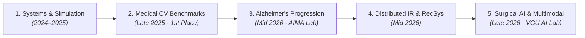

# Quang Minh Khoa Le
### Researcher in Surgical AI & Medical Computer Vision

  
  
  
  
  

---

### Research Overview

> [!NOTE]
> **Research Progression: From Neurodegenerative Progression to Surgical AI**  
> Previously at the **AI in Medical Applications Lab (AIMA)**, I investigated neurodegenerative disease progression in Alzheimer's disease using multimodal MRI and PET fusion and ordinal representation learning.  
> My current work at the **VGU AI Lab** centers on **Surgical AI**: developing topologically-aware landmark detection architectures and intraoperative 3D-to-2D image registration to assist minimally invasive laparoscopic liver procedures, alongside compact multimodal systems for clinical diagnosis in resource-constrained environments.

---

### Research Experience & Lab Affiliations

<table>
  <tr>
    <td width="75%"><strong>VGU AI Lab &mdash; Researcher</strong> Intraoperative Laparoscopic Surgical AI &amp; Landmark Detection</td>
    <td align="right" width="25%"><code>2025 &ndash; Present</code></td>
  </tr>
  <tr>
    <td colspan="2">
      <ul>
        <li>Authored technical research paper diagnosing geometric perspective disparity and temporal modeling in laparoscopic landmark segmentation, establishing state-of-the-art results on the L3D benchmark.</li>
        <li>Applied transformer-based segmenters (Mask2Former) with topological graph loss constraints to prevent anatomical boundary drift across temporal surgical video frames.</li>
        <li>Formulated 3D-to-2D algorithmic registration pipelines aligning preoperative patient CT models with real-time laparoscopic visual streams.</li>
      </ul>
    </td>
  </tr>
  <tr>
    <td width="75%"><strong>AI in Medical Applications Lab (AIMA) &mdash; Researcher</strong> Neurodegenerative Progression Modeling &amp; Volumetric Segmentation</td>
    <td align="right" width="25%"><code>2025 &ndash; Present</code></td>
  </tr>
  <tr>
    <td colspan="2">
      <ul>
        <li>Researched Alzheimer's Disease progression using paired MRI and PET scans, implementing modified triplet loss objectives to disentangle progression velocity from baseline severity.</li>
        <li>Replicated and extended the HOPE (Hybrid-granularity Ordinal Prototype lEarning) baseline for clinical cognitive impairment classification.</li>
        <li><strong>Competition Outcomes:</strong> 1st Place in AIO Liver CT Segmentation Challenge (Score: 0.972); 13th Place in AI Vietnam Dermoscopic Skin Lesion Segmentation (Score: 0.876).</li>
      </ul>
    </td>
  </tr>
</table>

---

### Selected Projects & Research Timeline

#### Phase 5: Surgical AI & Clinical Multimodal Intelligence (Mid &ndash; Late 2026)

<table>
  <tr>
    <td width="75%">
      <strong><a href="https://github.com/KhoaLeQuangMinh/registration-coding">Intraoperative Laparoscopic-to-Preoperative Image Registration</a></strong> 
      VGU AI Lab &middot; Surgical Navigation &middot; Author
    </td>
    <td align="right" width="25%"><code>Oct 2026</code></td>
  </tr>
  <tr>
    <td colspan="2">
      
       
      Algorithmic registration framework aligning preoperative 3D CT/MRI liver reconstructions with real-time laparoscopic video streams, compensating for intraoperative surface deformation. 
      <strong>Technologies:</strong> Python &middot; 3D Point Cloud Processing &middot; Rigid & Non-Rigid Registration &middot; Kaggle P2I-LReg
    </td>
  </tr>
  <tr>
    <td width="75%">
      <strong><a href="https://github.com/KhoaLeQuangMinh/Small-Multimodal-Models-for-Clinical-Diagnosis">Clinical Multimodal Diagnostics for Tropical Infectious Diseases</a></strong> 
      VGU AI Lab &middot; Supervised by Dr. Tran Duc Khanh &middot; Author
    </td>
    <td align="right" width="25%"><code>Sep 2026 &ndash; Oct 2026</code></td>
  </tr>
  <tr>
    <td colspan="2">
      
       
      End-to-end clinical diagnostic reasoning system uniting Small Multimodal Models (SMMs / SLMs) with Knowledge Graph Retrieval-Augmented Generation for verifiable tropical disease reasoning in low-resource settings. 
      <strong>Technologies:</strong> Small Multimodal Models &middot; LightRAG &middot; Knowledge Graphs &middot; PyTorch &middot; Medical Informatics
    </td>
  </tr>
  <tr>
    <td width="75%">
      <strong><a href="https://github.com/KhoaTryToCode/surgical_ai">Laparoscopic Landmark Segmentation &amp; Temporal Modeling</a></strong> 
      VGU AI Lab &middot; Research Lead &amp; Lead Author
    </td>
    <td align="right" width="25%"><code>Aug 2026 &ndash; Oct 2026</code></td>
  </tr>
  <tr>
    <td colspan="2">
      
       
      Official repository for the research paper <em>"Diagnosing Geometric Disparity and Temporal Modeling in Laparoscopic Liver Landmark Segmentation"</em>. Investigates perspective shifts and temporal continuity in minimally invasive surgical video streams. 
      <strong>Technologies:</strong> PyTorch &middot; Surgical Robotics &middot; Mask2Former &middot; Temporal Modeling &middot; LaTeX
    </td>
  </tr>
</table>

#### Phase 4: Scalable Multimodal Platforms & Information Retrieval (Mid 2026)

<table>
  <tr>
    <td width="75%">
      <strong><a href="https://github.com/AIVIETNAM-AIO-Dewey/AIC-2026">MultiRetrieval: Multimodal Video Retrieval Platform</a></strong> 
      HCMC AI Challenge 2026 &middot; Backend &amp; Video Retrieval Engineering
    </td>
    <td align="right" width="25%"><code>Aug 2026 &ndash; Sep 2026</code></td>
  </tr>
  <tr>
    <td colspan="2">
       
      High-throughput multimodal video search platform supporting Known-Item Search (KIS) and Question-Answering. Features dense keyframing, OCR, and ASR pipelines with SigLIP2 embeddings indexed in Qdrant. 
      <strong>Technologies:</strong> FastAPI &middot; Qdrant Vector DB &middot; SigLIP2 &middot; Dense Keyframing &middot; React
    </td>
  </tr>
  <tr>
    <td width="75%">
      <strong><a href="https://github.com/KhoaLeQuangMinh/LLM-Recommender">SmartCart: Distributed Recommendation with LLM Explanations</a></strong> 
      RecSys Architecture &middot; Author
    </td>
    <td align="right" width="25%"><code>Aug 2026</code></td>
  </tr>
  <tr>
    <td colspan="2">
      Scalable two-stage product recommendation engine pairing PySpark distributed Alternating Least Squares (ALS) matrix factorization with Google Gemini LLM contextual reasoning to synthesize natural language user purchase explanations. 
      <strong>Technologies:</strong> PySpark (ALS) &middot; Google Gemini API &middot; Flask REST API &middot; Collaborative Filtering
    </td>
  </tr>
  <tr>
    <td width="75%">
      <strong><a href="https://github.com/XuanSang2005/Agentic-AI">Tasco Maps: Deterministic POI Search &amp; Multi-Signal Ranking</a></strong> 
      AABW 2026 (Track 2) Competition &middot; Collaborator
    </td>
    <td align="right" width="25%"><code>Jul 2026</code></td>
  </tr>
  <tr>
    <td colspan="2">
      
       
      High-speed Vietnamese point-of-interest search engine uniting rule-based query comprehension with hybrid retrieval (BM25 &cup; dense union pool) and explainable multi-signal re-ranking with zero LLM runtime latency. 
      <strong>Technologies:</strong> Python &middot; BM25 &middot; Dense Retrieval &middot; Explainable Multi-Signal Re-Ranking
    </td>
  </tr>
</table>

#### Phase 3: Neurodegenerative Progression & Distributed Consensus (Mid 2026)

<table>
  <tr>
    <td width="75%">
      <strong><a href="https://github.com/KhoaLeQuangMinh/coding_space">Multimodal MRI+PET Alzheimer's Progression &amp; HOPE Baseline</a></strong> 
      AI in Medical Applications Lab (AIMA) &middot; Author
    </td>
    <td align="right" width="25%"><code>May 2026 &ndash; Jul 2026</code></td>
  </tr>
  <tr>
    <td colspan="2">
      Multimodal fusion framework combining paired structural MRI and metabolic PET brain scans for Alzheimer's classification. Replicated and extended the HOPE (Hybrid-granularity Ordinal Prototype lEarning) baseline using modified triplet loss to disentangle velocity from severity. 
      <strong>Technologies:</strong> PyTorch &middot; NiBabel &middot; SciPy &middot; MRI+PET Fusion &middot; Ordinal Metric Learning
    </td>
  </tr>
  <tr>
    <td width="75%">
      <strong><a href="https://github.com/Marcher-D/charity-ledger-monorepo">Charity Ledger Distributed Consensus Monorepo</a></strong> 
      Distributed Systems &middot; Collaborator
    </td>
    <td align="right" width="25%"><code>May 2026 &ndash; Jun 2026</code></td>
  </tr>
  <tr>
    <td colspan="2">
      Decentralized ledger architecture applying Proof-of-Stake consensus mechanisms for verifiable, immutable philanthropic audit tracking in a Java monorepo. 
      <strong>Technologies:</strong> Java &middot; Distributed Consensus &middot; Proof-of-Stake &middot; Cryptographic Auditing
    </td>
  </tr>
</table>

#### Phase 2: Medical Computer Vision Benchmarks (Late 2025)

<table>
  <tr>
    <td width="75%">
      <strong><a href="https://github.com/KhoaLeQuangMinh/3D_Liver_Segmentation">3D Volumetric Liver &amp; Tumor CT Segmentation</a></strong> 
      AIO 2025 LiverSeg Competition &middot; Author
    </td>
    <td align="right" width="25%"><code>Nov 2025 &ndash; Dec 2025</code></td>
  </tr>
  <tr>
    <td colspan="2">
       
      Automated segmentation pipeline for hepatic lesions in abdominal CT volumes. Overcame severe class imbalance and soft-tissue low contrast using slice filtering and geometric connected-component post-processing. 
      <strong>Technologies:</strong> PyTorch &middot; 3D CT Volumetric Imaging &middot; Semantic Segmentation &middot; Post-Processing
    </td>
  </tr>
  <tr>
    <td width="75%">
      <strong><a href="https://github.com/KhoaLeQuangMinh/Skin_Lesion_Segmentation">Dermoscopic Skin Lesion Segmentation</a></strong> 
      AI Vietnam WarmUp Challenge &middot; Author
    </td>
    <td align="right" width="25%"><code>Nov 2025</code></td>
  </tr>
  <tr>
    <td colspan="2">
       
      Deep convolutional semantic segmentation pipeline delineating malignant melanoma boundaries across variable skin pigmentation and illumination artifacts. 
      <strong>Technologies:</strong> PyTorch &middot; Computer Vision &middot; Dermoscopy &middot; U-Net
    </td>
  </tr>
</table>

#### Phase 1: Systems Engineering & Simulation (2024 &ndash; 2025)

<table>
  <tr>
    <td width="75%">
      <strong><a href="https://github.com/KiwisCodes/traffic-simulator">Real-Time Urban Traffic Simulation</a></strong> 
      Vietnamese-German University &middot; Co-developer (OOP in Java)
    </td>
    <td align="right" width="25%"><code>Nov 2025 &ndash; Dec 2025</code></td>
  </tr>
  <tr>
    <td colspan="2">
      Object-oriented Java application connected to the SUMO (Simulation of Urban MObility) microscopic simulation engine via TraaS API, featuring interactive JavaFX control and live flow analysis. 
      <strong>Technologies:</strong> Java &middot; JavaFX &middot; SUMO Simulator &middot; TraaS API &middot; OOP Architecture
    </td>
  </tr>
  <tr>
    <td width="75%">
      <strong><a href="https://github.com/hunggiadao/track-me-run-fitness">Fitness Activity Tracker</a></strong> 
      Multidisciplinary University Project &middot; Backend &amp; Data Pipeline
    </td>
    <td align="right" width="25%"><code>May 2024 &ndash; Jul 2024</code></td>
  </tr>
  <tr>
    <td colspan="2">
      Server backend and database architecture supporting mobile telemetry capture and exercise duration/biometric logging. 
      <strong>Technologies:</strong> Python &middot; Backend Engineering &middot; REST API
    </td>
  </tr>
</table>

---

### Technical Proficiencies

| Domain | Methodologies & Technologies |
| :--- | :--- |
| **Computer Vision & Medical AI** | PyTorch, Mask2Former, U-Net, NiBabel, FreeSurfer, ANTs, Volumetric CT/MRI, 3D Point Cloud Registration, Temporal Video Modeling |
| **Multimodal & Information Retrieval** | Small Multimodal Models (SMMs), Knowledge Graph RAG (LightRAG), SigLIP2, Dense Embeddings, BM25, Qdrant Vector DB, PySpark (ALS) |
| **Languages & Systems** | Python, Java (OOP, JavaFX), R, SQL, Git, Linux, Docker, FastAPI, Flask, LaTeX |
| **Spoken Languages** | Vietnamese (Native), English (Fluent / C1, 1500 SAT), German (Basic / A2) |

---

  Quang Minh Khoa Le &middot; <a href="https://khoalequangminh.github.io">Personal Portfolio</a> &middot; <a href="https://github.com/KhoaLeQuangMinh">GitHub Profile</a>

